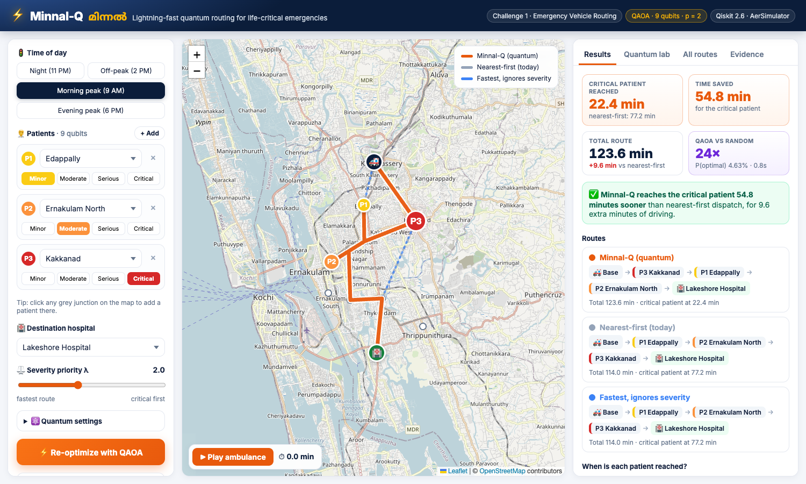
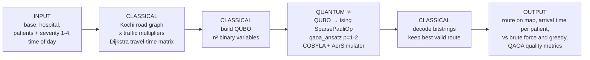

# ⚡ Minnal-Q (മിന്നൽ)
### Lightning-fast quantum routing for life-critical emergencies

| | |
|---|---|
| **Team name** | Minnal-Q |
| **Project** | Minnal-Q: Severity- and Traffic-Aware Multi-Stop Ambulance Routing with QAOA |
| **Challenge** | Challenge 1: Emergency Vehicle Routing (Quantum Optimization · Smart Mobility) |
| **Members (roles)** | Rahul M J · _add other team members here_ |
| **Event** | QFF26 Kochi Hack · TinkerSpace Kochi · 1 November 2026 |

*Minnal* is Malayalam for lightning. **Q** stands for the quantum (QAOA) engine.



---

## 1. Problem statement

In a mass-casualty event, such as a bus accident on NH-66, monsoon flooding or a building collapse, one
ambulance often has to reach several injured people before going to a hospital. Dispatchers usually go to
the **nearest** patient first. That keeps driving short, but it can leave a **critically injured patient
waiting** while minor cases are seen. Kochi's traffic changes sharply through the day (Edappally, Vyttila,
Kaloor, MG Road), so the best order at 9 a.m. is not the best order at 11 p.m.

The people affected are patients whose survival depends on time to treatment (trauma, cardiac arrest,
stroke), plus ambulance crews and hospital emergency teams.

**What we optimize:** the order in which one ambulance visits *n* patients, starting from its base and
ending at a hospital. We minimize traffic-adjusted travel time while strongly preferring early visits to
high-severity patients. The number of possible orders grows as *n*!, and severity plus time-dependent
traffic make simple nearest-first rules unreliable. Choosing an order is a binary combinatorial problem
with pairwise costs, which makes it a natural QUBO for QAOA. (SDG 3: Good Health · SDG 11: Sustainable Cities)

## 2. Solution: Input → Processing → Output



## 3. Quantum component (mandatory)

**Where quantum is used:** in one place, choosing the **visiting order**. The QAOA circuit's output *is*
the route. Remove it and Minnal-Q has no answer, so it is not a decorative circuit.

**Why QAOA fits:** each decision ("is patient *i* at stop *p*?") is a yes/no variable, and travel cost
depends on *which two patients are consecutive*. That pairwise structure is exactly a QUBO, and QAOA is
designed to minimize QUBOs on today's (simulated or noisy) quantum devices.

**Mapping:** qubit `k = i·n + p` is 1 if patient *i* is visited at stop *p*. 3 patients use **9 qubits**;
4 patients use **16 qubits**.

**QUBO** ([`minnal_q/qubo.py`](minnal_q/qubo.py)):

```
H(x) = A·Σ_i (1 − Σ_p x[i,p])² + A·Σ_p (1 − Σ_i x[i,p])²          each patient once, each stop once
     + Σ_i T[S,i]·x[i,0] + Σ_{i≠j} Σ_p T[i,j]·x[i,p]·x[j,p+1]
     + Σ_i T[i,H]·x[i,n−1]                                          traffic-adjusted travel time
     + λ·Σ_i Σ_p w_i·p·x[i,p]                                       critical patients earlier
```

- `T` = Dijkstra travel times for the chosen time slot. `w_i` ∈ {1, 2, 4, 8} for severity 1–4. λ = severity priority (default 2).
- **Penalty A** is chosen automatically: the smallest value (starting at the longest leg, ×1.5 steps) for which
  an exhaustive check over all 2^N bitstrings confirms the QUBO's lowest energy is the brute-force optimum.

**Circuit and algorithm** ([`minnal_q/qaoa.py`](minnal_q/qaoa.py)):

1. QUBO → Ising (`x = (1 − Z)/2`), built as a `SparsePauliOp` and normalised by its largest coefficient.
2. `qiskit.circuit.library.qaoa_ansatz(cost_operator, reps=p)`, p = 1 or 2: Hadamards, then alternating cost (γ) and mixer (β) layers.
3. **Hybrid loop:** SciPy **COBYLA** (classical) tunes γ, β with 3 restarts; the circuit is evaluated by exact
   statevector simulation (`qiskit.quantum_info.Statevector`). The objective is **CVaR (α = 0.2)** by default,
   with plain expectation as an option. p = 2 is warm-started from the p = 1 angles.
4. **Sampling:** the trained circuit is transpiled and run on **`qiskit_aer.AerSimulator`** via
   `qiskit_aer.primitives.SamplerV2`, 4,096 shots. Bitstrings are decoded, invalid ones discarded, and the
   lowest-cost valid route is returned.
5. **Optional hardware:** [`run_ibm.py`](run_ibm.py) runs the 9-qubit circuit on the least busy IBM backend with
   `generate_preset_pass_manager` + `qiskit_ibm_runtime.SamplerV2`, and saves the job ID to `results/ibm_run.json`.

## 4. Qiskit usage

| Component | Use |
|---|---|
| `qiskit.quantum_info.SparsePauliOp` | Ising cost operator (Z and ZZ terms) |
| `qiskit.circuit.library.qaoa_ansatz` | QAOA circuit |
| `qiskit.quantum_info.Statevector` | Exact objective during training |
| `qiskit_aer.AerSimulator` + `qiskit_aer.primitives.SamplerV2` | **Backend for all reported results** (4,096 shots) |
| `qiskit.transpile` | Compile to simulator basis gates; depth and gate counts reported |
| `qiskit_ibm_runtime` (optional) | Real-hardware run, `run_ibm.py` |

**Classical ↔ quantum interaction:** classical code builds the graph, the travel times and the QUBO; the
quantum circuit produces route samples; a classical optimizer tunes the circuit; classical code decodes and
verifies the result against brute force.

## 5. Results (measured, `results/benchmark.csv`)

Demo scenario: base at Kalamassery, hospital Lakeshore; patients at Edappally (minor), Ernakulam North
(moderate) and Kakkanad (critical). The 4-patient version adds Palarivattom (minor). λ = 2.

**Effect on patients (3 patients):**

| Time slot | Greedy: critical patient reached | **Minnal-Q: critical patient reached** | Greedy total | Minnal-Q total |
|---|---|---|---|---|
| Night (11 PM) | 36.8 min | **11.2 min** | 53.6 | 60.0 |
| Off-peak (2 PM) | 51.2 min | **15.4 min** | 73.5 | 81.6 |
| Morning peak (9 AM) | 77.2 min | **22.4 min** | 114.0 | 123.6 |
| Evening peak (6 PM) | 40.4 min | **21.0 min** | 127.6 | **127.4** |

At morning peak the critical patient is reached **54.8 minutes sooner** for 9.6 extra minutes of total
driving. At evening peak Minnal-Q is better on both measures.

**QAOA quality (AerSimulator, CVaR, 3 restarts):**

| Patients | Qubits | p | Found exact optimum | P(optimal route) | vs random guessing | Valid samples | Depth | 2-qubit gates | Time |
|---|---|---|---|---|---|---|---|---|---|
| 3 | 9 | 1 | 4 / 4 slots | 1.1–2.2% | 5–11× | 6–14% | 18 | 30 | < 1 s |
| 3 | 9 | 2 | 4 / 4 slots | 3.4–4.6% | 17–24× | 20–25% | 29 | 60 | < 1 s |
| 4 | 16 | 1 | 4 / 4 slots | 0.08–0.19% | 49–63× | 1–2% | 32 | 84 | ~3 s |
| 4 | 16 | 2 | 4 / 4 slots | 0.41–1.24% | 266–408× | 9–14% | 48 | 168 | ~14 s |

Random guessing would pick a valid route 1.2% (9 qubits) or 0.04% (16 qubits) of the time. QAOA concentrates
probability on valid, low-cost routes, and more so at p = 2.

## 6. Demo web app

A single-page web app served by FastAPI (no Streamlit):

- **Interactive Kochi map** (Leaflet + OpenStreetMap): patients as severity-coloured pins. Click any junction to add a patient.
- **Three routes drawn on real roads:** Minnal-Q (quantum), nearest-first (today) and fastest (ignores severity).
- **▶ Play ambulance:** animates the ambulance along the Minnal-Q route with a live minute counter.
- **Results:** critical-patient arrival, minutes saved, total time, QAOA vs random; patient timeline.
- **Quantum lab:** P(optimal) for random vs p = 1 vs p = 2, measured-route histogram, qubit grid with the optimal route lit, training curve.
- **All routes and Evidence:** every possible order with tags, live correctness checks, transparency table, references.

Quantum runs execute in a dedicated large-stack thread, one at a time (`minnal_q/runtime.py`), so several browser tabs are safe.

## 6b. Setup and run (reproducible)

```bash
git clone <this repo> && cd quantum-hackday
python3.11 -m venv qiskit-env && source qiskit-env/bin/activate
pip install -r requirements.txt

pytest -q                     # 22 tests: QUBO = route cost, ground state = brute force, Ising = QUBO, QAOA > random, API
python run_experiments.py     # regenerates results/benchmark.csv (≈ 1 min)
uvicorn server:app --port 8077   # web app at http://localhost:8077

# optional real hardware (needs an IBM Quantum API key)
python save_key.py            # stores the key in ~/.qiskit, not in this repo
python run_ibm.py
```

Configuration: time slot, patients, severities, hospital, λ, QAOA depth and objective are set in the app's
sidebar. Random seeds are fixed (`seed=7`). Data: no external dataset. The road graph is defined in
[`minnal_q/city.py`](minnal_q/city.py).

## 7. Project structure

```
minnal_q/city.py        Kochi junction graph, traffic multipliers, Dijkstra travel-time matrix
minnal_q/scenario.py    Patients, severities, exact route evaluation (arrival times)
minnal_q/classical.py   Brute force (exact), nearest-first greedy, fastest route
minnal_q/qubo.py        QUBO builder, auto-penalty, QUBO→Ising, decode/encode
minnal_q/qaoa.py        qaoa_ansatz + COBYLA + Aer SamplerV2, metrics
server.py               FastAPI backend: /api/meta, /api/optimize (runs QAOA, returns routes + metrics)
web/                    Frontend: Leaflet map, animated ambulance, results, Chart.js quantum lab, evidence
run_experiments.py      Benchmark → results/benchmark.csv
run_ibm.py              Optional IBM hardware run → results/ibm_run.json
tests/                  22 tests (QUBO/Ising/QAOA + API)
docs/                   Concept, quantum explainer and use-case PDFs
```

## 8. Transparency

| | |
|---|---|
| **Implemented** | Road graph + traffic, Dijkstra, QUBO, QUBO→Ising, QAOA + COBYLA, Aer sampling, three baselines, web app (FastAPI + Leaflet), 22 tests |
| **Simulated** | All reported QAOA results use Qiskit Aer / statevector simulation (no hardware noise) |
| **Synthetic** | Travel times, traffic multipliers and patient locations. Place names are real Kochi locations; coordinates are approximate |
| **Measured** | Everything in Section 5 (`results/benchmark.csv`) |
| **Modelling note** | Exact severity-weighted arrival time would need higher-order terms, so the QUBO uses a quadratic position penalty `λ·w·p`. Reported arrival times are recomputed exactly |
| **Not claimed** | Quantum advantage. At 3–4 patients brute force is instant, and with 6 valid routes, 4,096 samples will almost surely contain the optimum. The meaningful quantum metrics are P(optimal) and valid-sample rate vs random |
| **Incomplete** | Real-hardware run unless `results/ibm_run.json` is present; multi-ambulance splitting is future work |

## 9. Future work

Real OpenStreetMap roads (OSMnx) and live traffic · several ambulances (classical split, then one QAOA per
ambulance) · flood and landslide scenarios with blocked roads · hospital capacity · constraint-preserving
(XY) mixers to raise the valid-route rate · error mitigation on IBM hardware.
